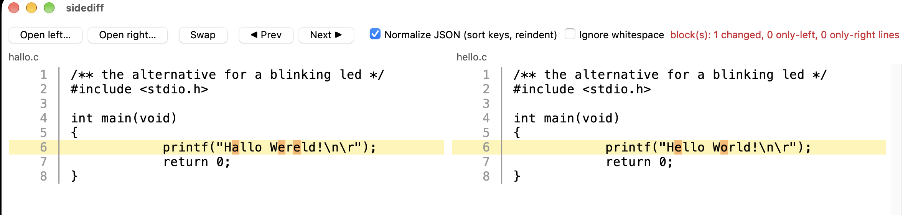

# Comparing Files

Sometimes it is neccessary to compare a few files to check if they are the same or not. There are many ways and/or tools to do that. Here are three ways to do it on a Mac running OSX (should work for Linux too).



## Plain CLI

```bash
# unified diff (like git)
diff -u dirA/config.json dirB/config.json

# side by side in the terminal
diff -y -W 200 dirA/script.py dirB/script.py

# which files differ between the two directories (names only)
diff -rq dirA dirB

# colored, more readable (requires git, which is included in Xcode Command Line Tools)
git diff --no-index dirA/script.py dirB/script.py
```

JSON tip: two JSON files can be identical in meaning but have different key order or indentation, and plain diff reports all of that as changes. So sort them first, then compare. This normalizes both before diffing, using only Python’s standard library:

```bash
diff -u <(python3 -m json.tool --sort-keys dirA/a.json) \
        <(python3 -m json.tool --sort-keys dirB/a.json)
```

# VS Code side by side

```bash
code --diff /path/dirA/script.py /path/dirB/script.py
```
If code isn’t found, open VS Code, press Cmd+Shift+P, and run Shell Command: Install ‘code’ command in PATH.

You can also compare without the terminal. Open both files, then run **File: Compare Active File With…** from the Command Palette. Or, in the Explorer, right-click the first file and choose Select for Compare, then right-click the second and choose Compare with Selected.

**FileMerge** is a third side-by-side option: `opendiff fileA fileB`. It only works if the **full Xcode app** is installed, not just the Command Line Tools.

# Python window: sidediff.py

```bash
python3 sidediff.py                 # file pickers for left and right
python3 sidediff.py a.json b.json   # open two files directly
```

File selection: each side has its own picker, so the two files can be in any two folders.

Colors: red lines exist only on the left, green only on the right, yellow lines changed. Orange marks the exact characters that changed within a line.

Normalize JSON (on by default) sorts keys and reindents before comparing. Ignore whitespace is optional.

Navigation: the two panes scroll together. Next/Prev (or the n/p keys) jump between differences, r reloads, and Swap flips left and right.

Dependencies: none beyond the standard library (tkinter + difflib).

# How to turn sidediff.py into an executable?

Three options, depending on how you want to start it. 

The script already starts with `#!/usr/bin/env python3`, so the first two need no code changes.

## Terminal command (sidediff a.json b.json)

```bash
mkdir -p ~/.local/bin
cp sidediff.py ~/.local/bin/sidediff      # drop the .py
chmod +x ~/.local/bin/sidediff
echo 'export PATH="$HOME/.local/bin:$PATH"' >> ~/.zshrc
source ~/.zshrc
```

After that, `sidediff` works from any folder, with or without two file arguments.

Beware that `#!/usr/bin/env python3` runs whichever python3 comes first in your PATH. If that is Apple’s version with the old Tk, point the first line at a specific Python instead:

**python.org install** use: `#!/Library/Frameworks/Python.framework/Versions/3.13/bin/python3`

**Homebrew on Apple Silicon** use: `#!/opt/homebrew/bin/python3`

Run `which -a python3` to find out which python is in use.

## Double-click in Finder, quick version

```bash
cp sidediff.py ~/Desktop/SideDiff.command
chmod +x ~/Desktop/SideDiff.command
```

Double-clicking runs it and opens the file pickers. The downside is that a Terminal window also opens next to it.

## A real SideDiff.app with PyInstaller

```bash
python3 -m venv ~/.venvs/sidediff
source ~/.venvs/sidediff/bin/activate
pip install pyinstaller
pyinstaller --windowed --argv-emulation --name SideDiff sidediff.py
```

The app ends up in `dist/SideDiff.app`; drag it to `/Applications`.

The app carries its own copy of Python and Tk, so it doesn’t depend on what’s installed later.

`--windowed`: no Terminal window opens.

`--argv-emulation`: dragging two files onto the app icon opens them directly, just like passing them as arguments. If you double-click the app instead, you get the file pickers.

An app you build on your own Mac normally opens without warnings. If you copy it to another Mac and it gets blocked, right-click it and choose `Open`, or `run xattr -dr com.apple.quarantine /Applications/SideDiff.app`.

